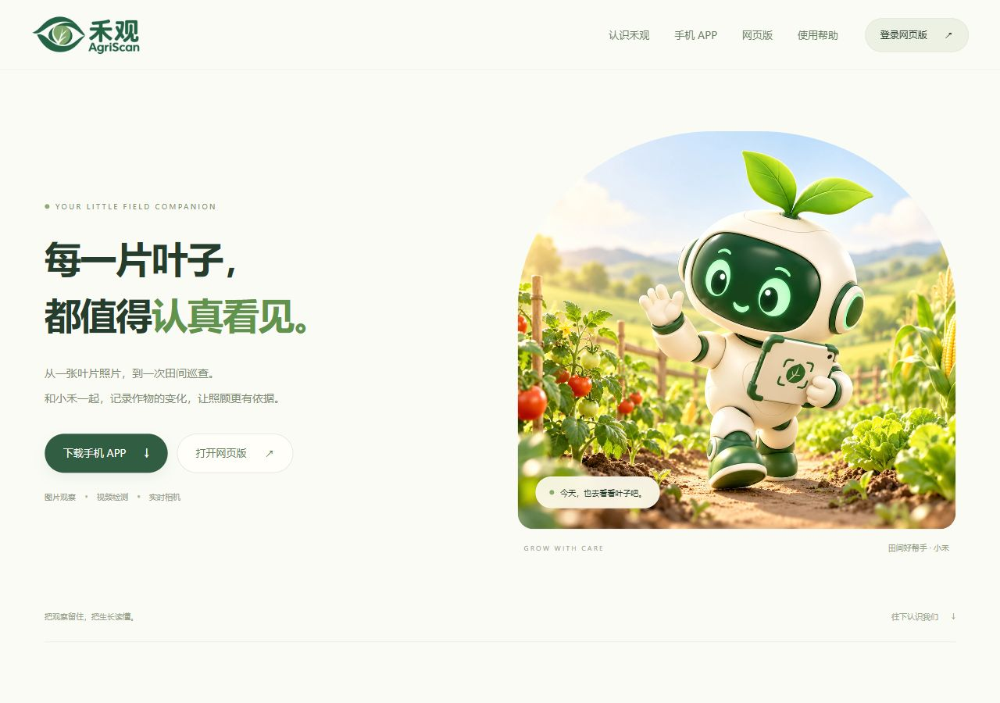
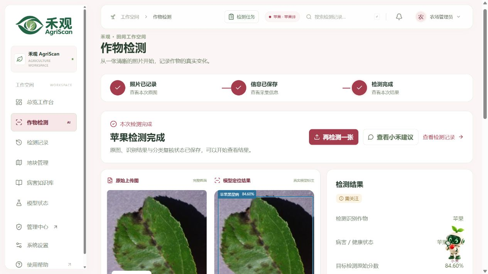
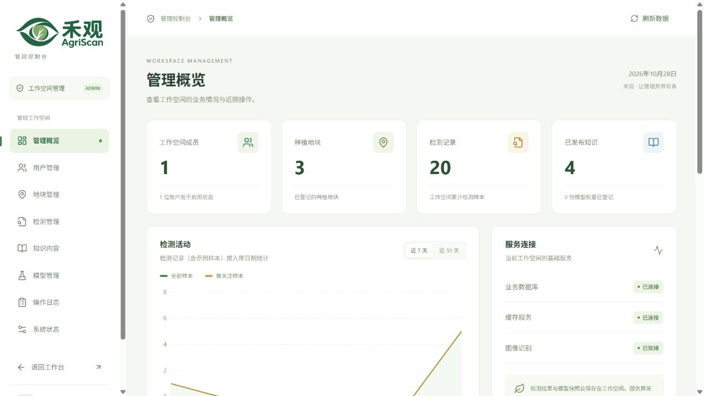
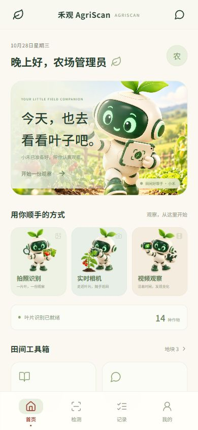

<div align="center">
  
  <h1>禾观 AgriScan</h1>
  <p><strong>让每一片叶子的变化，都成为看得见的田间记录。</strong></p>
  <p>自动识别作物与病害 · 真实目标检测 · 桌面、手机与独立管理</p>
  <p>
    
    
    
    
  </p>
  <p>
    <a href="https://agriscan.ming-ai.top/agriscan/">访问官网</a> ·
    <a href="https://agriscan.ming-ai.top/agriscan/workspace/#login">打开网页版</a> ·
    <a href="https://agriscan.ming-ai.top/agriscan/admin/">管理控制台</a> ·
    <a href="https://agriscan.ming-ai.top/agriscan/downloads/agriscan-test.apk">下载 Android 测试版</a>
  </p>
</div>

> **分支说明**：`main` 保留初始代码并更新项目展示；最新完整功能位于 [`codex/workspace-ui-and-plot-management-20261028`](https://github.com/yuxiaopao/AgriScan/tree/codex/workspace-ui-and-plot-management-20261028)。体验源码请克隆该功能分支，下方技术文档也指向该分支。
>
> **在线访问**：官网已迁移至 `agriscan.ming-ai.top`，直接访问域名会进入官网。Android 下载为独立发布的调试签名测试包，不随 Git 源码提交；真机体验仍需自行验证。

## 从观察一片叶子开始

上传图片后，禾观自动识别作物、切换对应主题，并给出病害类别、置信度与真实目标框。检测结果可以关联地块、保存原图、回看历史，再交给农业助手「小禾」继续分析。管理员在独立控制台维护数据与运行配置。

当前接入 **14 种作物、38 个健康与病害类别**的 ONNX 目标检测模型，支持 CPU 推理。检测框标示模型识别的目标范围，不代表病斑精细分割；目前没有独立检测 mAP，不能沿用旧分类模型的准确率。

## 界面一览

**官网 · 产品介绍与统一入口**



<table>
  <tr>
    <td width="50%"><strong>桌面工作台 · 原图与真实检测框</strong></td>
    <td width="50%"><strong>独立管理端 · 示例数据预览</strong></td>
  </tr>
  <tr>
    <td></td>
    <td></td>
  </tr>
</table>

<table>
  <tr>
    <td width="50%" align="center"><strong>手机首页</strong></td>
    <td width="50%" align="center"><strong>手机欢迎引导</strong></td>
  </tr>
  <tr>
    <td align="center"></td>
    <td align="center"></td>
  </tr>
</table>

<sub>桌面检测图来自生产环境 YOLO 实际推理；管理端为示例数据预览。移动端为界面示例的浏览器预览，并非真机实拍；Android 安装、硬件相机及厂商权限行为需真机验收。</sub>

## 三个入口，各司其职

| 能力 | 桌面用户端 | 手机 APP | 独立管理端 |
| --- | --- | --- | --- |
| 图片自动识别 | 作物、病害、原图与检测框对照 | 拍照 / 选图、识别与结果查看 | 检索、维护检测记录 |
| 视频检测 | — | 按时间采样，查看各时点结果 | 管理保存的采样记录 |
| 实时相机 | — | 串行抽帧预览，按需保存 | 控制入口与请求间隔 |
| 地块与观察档案 | 查看、筛选及权限内维护 | 地块、记录与历史详情 | 全局维护、筛选与 CSV 导出 |
| 农业知识 | 查阅已发布内容 | 分类浏览与搜索 | 草稿、编辑、发布与归档 |
| 小禾农业助手 | 悬浮窗口、向左展开历史 | 私人会话与历史 | 配置服务地址、模型与密钥 |
| 账号与系统 | 登录注册、个人偏好 | 欢迎引导、登录注册、服务设置 | 成员角色、停用、密码重置、品牌公告及功能限额 |

小禾的正常问答、图片分析与建议依赖管理员配置可用的大模型服务；未配置或连接失败时显示真实错误。邮件验证码同样需要可用的 SMTP 服务。视频采用采样检测，实时模式按间隔识别，不提供连续目标追踪；各端权限由后端校验。

## 获取完整代码

需要 Git LFS、Node.js **22.12+**、Python **3.12+**；本机启动脚本使用 Windows PowerShell，Docker Desktop 负责 MySQL 与 Redis。

```powershell
git lfs install
git clone --branch codex/workspace-ui-and-plot-management-20261028 --single-branch https://github.com/yuxiaopao/AgriScan.git
cd AgriScan
git lfs pull
```

先按[后端配置说明](https://github.com/yuxiaopao/AgriScan/blob/codex/workspace-ui-and-plot-management-20261028/backend/README.md)准备根目录及 `backend/` 的 `.env`；当前检测清单为 `models/candidates/user-detect-fafc2bb3ce9e/manifest.json`。真实凭据、数据库和上传图片不随仓库提供。

`git lfs pull` 获取仓库已有的分类模型；**新版检测 `model.onnx` 需单独取得**，按[模型恢复说明](https://github.com/yuxiaopao/AgriScan/blob/codex/workspace-ui-and-plot-management-20261028/models/candidates/user-detect-fafc2bb3ce9e/README.md#从源码仓库恢复模型)放置并核对 SHA256。只启动界面与样本采集时，可将 `MODEL_MANIFEST` 留空，此时不会生成识别结论。

```powershell
.\scripts\start-dev.ps1 -Install      # API + 桌面端；首次安装依赖
.\scripts\start-clients.ps1 -Install  # 复用 API，启动手机预览 + 管理端
```

本机入口：桌面 `http://127.0.0.1:5173` · 手机预览 `http://127.0.0.1:5174` · 管理端 `http://127.0.0.1:5175`。管理员使用 `backend/.env` 中配置的账户；三个界面分别管理登录会话。

Android 构建另需 **JDK 21 + Android SDK 36**，执行 `scripts/build-android.ps1`；正式发行需项目所有者保管发布签名。完整步骤见 [APP 与 APK 文档](https://github.com/yuxiaopao/AgriScan/blob/codex/workspace-ui-and-plot-management-20261028/mobile/README.md)。

## 功能分支目录

```text
frontend/   桌面工作台                 mobile/     手机界面与 Android 工程
admin/      独立管理控制台             backend/    FastAPI、鉴权与数据库迁移
website/    官网静态页面               models/     模型清单、权重与校验报告
scripts/    本机启动及构建脚本         deploy/     生产部署工具与说明
docs/       配置、验收与项目文档       design/     小禾 IP 与界面素材记录
```

## 继续了解

| 文档 | 内容 |
| --- | --- |
| [APP 与 Android](https://github.com/yuxiaopao/AgriScan/blob/codex/workspace-ui-and-plot-management-20261028/mobile/README.md) | 手机功能、HTTPS 服务地址、权限与 APK 构建 |
| [管理控制台](https://github.com/yuxiaopao/AgriScan/blob/codex/workspace-ui-and-plot-management-20261028/admin/README.md) | 独立登录、共享组件与部署 |
| [运行配置](https://github.com/yuxiaopao/AgriScan/blob/codex/workspace-ui-and-plot-management-20261028/docs/client-and-admin.md) | 品牌、开关、限额、SMTP / LLM 与密钥保管 |
| [后端与数据](https://github.com/yuxiaopao/AgriScan/blob/codex/workspace-ui-and-plot-management-20261028/backend/README.md) | API、数据库迁移与旧数据导入 |
| [当前检测模型](https://github.com/yuxiaopao/AgriScan/blob/codex/workspace-ui-and-plot-management-20261028/models/candidates/user-detect-fafc2bb3ce9e/README.md) | 38 类映射、ONNX 导出及一致性校验边界 |
| [生产部署](https://github.com/yuxiaopao/AgriScan/blob/codex/workspace-ui-and-plot-management-20261028/deploy/README.md) | 域名前缀、独立服务、模型与安装包发布 |
| [新域名迁移验收](https://github.com/yuxiaopao/AgriScan/blob/codex/workspace-ui-and-plot-management-20261028/docs/domain-migration-20261029.md) | 当前网址、证书续期、APP 升级与真实生产检查 |
| [生产验收记录](https://github.com/yuxiaopao/AgriScan/blob/codex/workspace-ui-and-plot-management-20261028/docs/QA-2026-10-28.md) | 真实页面点击、检测结果、已知限制与证据 |

<div align="center"><sub>禾观 AgriScan · 用心守护每一份绿意</sub></div>
