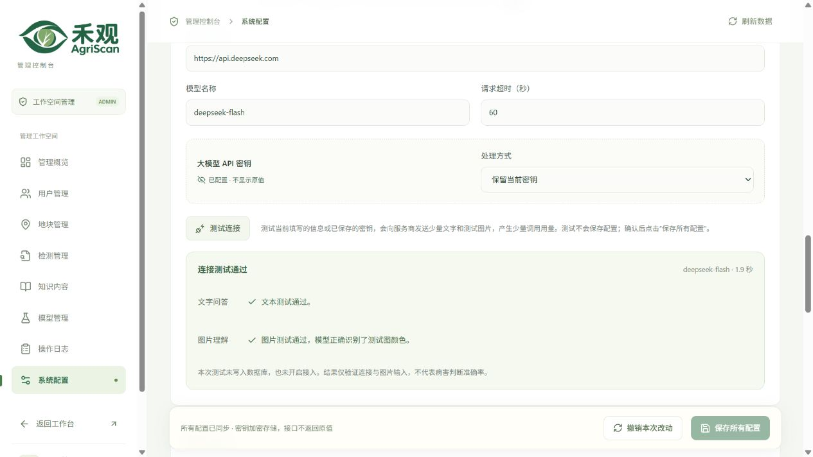
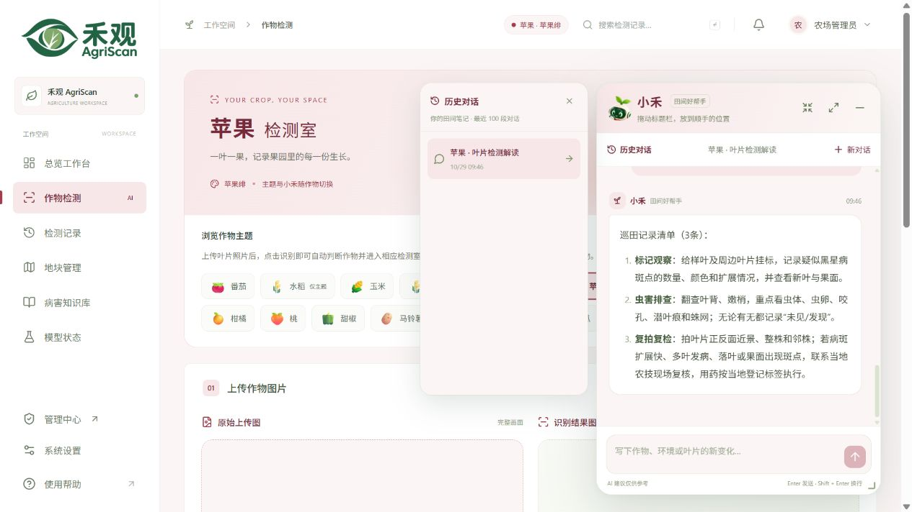

# DeepSeek 接入与小禾对话区验收 · 2026-10-29

生产环境已通过测试接入 DeepSeek，使用 `deepseek-flash`，配置版本为 v6。地址、模型、超时和启用状态存入数据库；API 密钥使用现有 Fernet 机制加密存入 `workspace_configuration.encrypted_secrets`，没有写入前端、APK 或 Git。

## 管理员入口

[管理端 → 系统配置](https://agriscan.ming-ai.top/agriscan/admin/#admin/settings)中的「小禾大模型服务」可操作：

1. 点击「填入 DeepSeek 配置」，自动填写 `https://api.deepseek.com` 和 `deepseek-flash`；也可填写其他兼容服务。
2. 选择保留当前密钥、替换为新密钥或清除密钥。已存密钥只显示「已配置」，不回显原值。
3. 点击「测试连接」，分别查看文字与图片测试结果。测试使用短文本及服务器生成的随机颜色图，不发送业务照片，不保存配置，也不改变接入开关。
4. 确认后明确点击「保存所有配置」。版本冲突返回 409，避免覆盖其他管理员的编辑。

本次先完成供应商预检，再通过生产测试接口复测，成功后才保存。一次生产探测未通过时没有写库；复测文字和颜色识别通过后，数据库配置从 v5 更新为 v6。该测试验证连接及图像输入，不代表病害诊断准确率。

新增接口 `POST /api/admin/config/llm/test` 仅限管理员。请求字段为 `llm_base_url`、`llm_model`、`llm_timeout`，可选写入式 `llm_api_key`。省略密钥时，只允许复用相同基础地址的已存密钥，避免把原密钥转发到其他服务。匿名为 401，普通成员为 403。

服务端保持 TLS 校验并拒绝跟随重定向；单项探测设最长 25 秒整体截止时间，两项最多约 50 秒，响应逐块读取且最多 64 KiB。供应商错误正文和含密钥的验证输入不会返回客户端。测试不写数据库或审计；保存时审计仅记录字段名。

## 悬浮对话区

- 长分析按小节、段落和清单显示，支持粗体与行内代码。仅渲染 React 文本节点，模型输出的 HTML 不会执行。
- 检测上下文卡片突出作物、结果、目标置信度和目标数量，样本信息可展开。
- 明确区分提问、回复、等待状态与失败重试；输入区自动增高，显示字数及键盘操作提示。
- 向上阅读时保留当前位置，收到新回复后可点击「回到最新」。历史菜单向左展开，主对话区不被覆盖；保留窗口放大、还原、拖拽与缩放交互。
- 中文小节序号原样显示，数字序号显示为 01、02 等。

## 验收结果

| 检查 | 结果 |
| --- | --- |
| 供应商预检 | 模型列表声明 `deepseek-flash` 支持 text/image；文字回复和合成红色方块识别均为 200 |
| 保存前生产探测 | 文字与随机颜色识别通过，配置版本、完整配置和加密数据库行均未变化 |
| 数据库存储 | 密文可解密且与提交密钥一致；非秘密 JSON、密文字符串和审计中均不含原始密钥 |
| 配置隔离 | 品牌、功能、检测限额、SMTP 和注册配置保留；公共配置不返回 integrations |
| 管理端实际点击 | 读取 v6，密钥只显示已配置；点击「测试连接」后文字、图片分项均通过，未改变保存配置 |
| 实际助手协议 | 数据库配置直接驱动农业知识问答，返回有效中文回答 |
| 叶片图片解读 | 真实苹果叶检测后，保存六节图片观察、虫害排查和复检建议；模型分数为 84.60%，1 个真实目标框 |
| 悬浮窗追问 | 追问返回三条清单，粗体和有序列表正常显示；刷新后同一对话可恢复 |
| 阅读位置 | 回复前后 scrollTop 均为 688.6667，显示「回到最新」；点击后正常到末尾 |
| 历史布局 | 历史菜单右边界 825.33，主对话左边界 837.33，没有重叠；页面无横向溢出 |
| 界面与安全渲染 | 用户端、管理端生产构建通过；实际 React 渲染的 5 类排版和 HTML 转义检查通过 |
| 后端完整回归 | 最终代码 231 passed、1 skipped；其中连接探测与运行配置定向 60 项通过 |
| 测试数据清理 | 精确核对所有权后移除本次 1 条检测、关联图片、1 段对话和 4 条消息；原有 2 条业务检测和已有对话保留，配置仍为 v6 |

本次不进行 APP 真机验收，不把辅助图像观察当作现场确诊。SMTP 仍未配置；外部大模型调用受服务商网络、余额和限额影响，失败时仍显示错误与重试。

## 发布与维护

代码发布到独立目录 `/srv/agriscan/releases/release-20261029-llm-assistant-093639`，原版本保留，`current` 原子切换。未变更模型、数据库结构、Nginx 虚拟主机、证书和生产环境文件。新增网页入口 HTML 的 `Cache-Control: no-cache, must-revalidate`，避免更新后继续使用旧入口；旧浏览器页面首次体验请刷新。

配置写入前的加密数据库行保存在服务器受限目录 `/srv/agriscan/shared/backups/deepseek-20261029/`。原始密钥、环境加密密钥和运行时报告不随仓库提交。恢复时须同时保留数据库、`CONFIG_ENCRYPTION_KEY` 及用户上传；不更换加密密钥来尝试修复配置。

图像请求格式参考 [DeepSeek 官方 Vision 文档](https://api-docs.deepseek.com/guides/vision/)。部署及历史域名检查见[部署说明](../deploy/README.md)与[新域迁移验收](domain-migration-20261029.md)。
