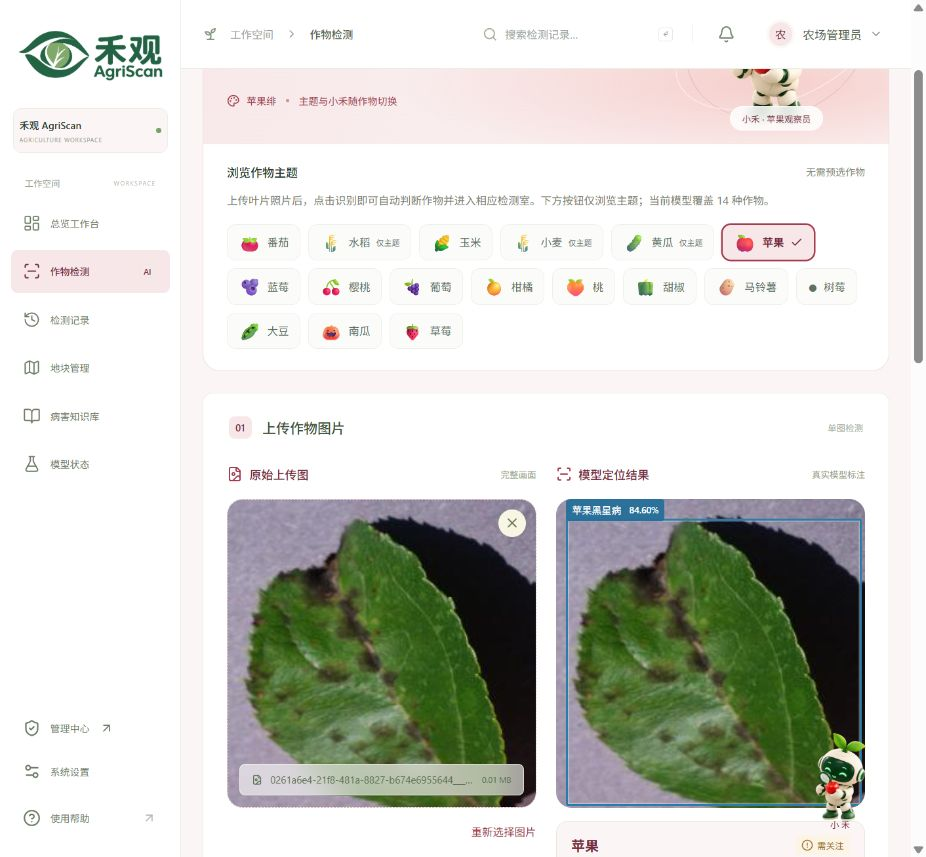

# 新域名迁移与生产验收 · 2026-10-29

> 本文保留域名迁移当时的配置与验收结果。同日后续已启用 DeepSeek 并升级小禾对话区，当前状态见 [DeepSeek 接入验收](deepseek-assistant-20261029.md)。

禾观已迁移到 **agriscan.ming-ai.top**，继续使用现有业务数据、上传文件与检测模型。此报告记录新域的实际生产检查；2026-10-28 的旧域验收保留原始结果。

## 当前入口

| 入口 | 地址 |
| --- | --- |
| 域名首页 | https://agriscan.ming-ai.top/ |
| 官网 | https://agriscan.ming-ai.top/agriscan/ |
| 用户工作台 | https://agriscan.ming-ai.top/agriscan/workspace/#login |
| 独立管理端 | https://agriscan.ming-ai.top/agriscan/admin/ |
| Android 测试包 | https://agriscan.ming-ai.top/agriscan/downloads/agriscan-test.apk |
| 版本与校验信息 | https://agriscan.ming-ai.top/agriscan/downloads/release.json |

HTTP 请求先 301 转到 HTTPS；HTTPS 根路径 302 转到 `/agriscan/`。沿用 `/agriscan/` 前缀，网页工作台和管理端通过同源相对路径访问 API。

## 服务器变更

- 公网及权威 DNS 的 A 记录为 `162.14.71.77`。
- 新增独立虚拟主机 `/etc/nginx/conf.d/zz-agriscan.conf`，复用 `/etc/nginx/agriscan-locations.inc`。文件排在原 Flowly 配置之后；没有改写其默认站点、原根页面或 `/app.apk` 路由。
- 签发新域专用 Let's Encrypt YE1 证书，CN/SAN 均为 `agriscan.ming-ai.top`，有效期至 **2027-01-27**。正常域名访问校验证书链和主机名，没有使用 `-k` 或关闭证书校验。
- 生产环境仅在 `CORS_ORIGINS` 追加新 HTTPS 来源，保留旧域和 Capacitor/localhost 来源；API 因此重启一次，重启后为 active/running，`NRestarts=0`。
- `certbot-renew.timer` 保持启用，续期服务保留 Nginx reload hook。新域 staging 续期演练成功，生产证书未被替换。手动验收通过 `--no-random-sleep-on-renew` 跳过随机延迟，定时续期策略未改。
- 官网 `canonical`、Open Graph 地址和图片地址同步为新域；根 README、部署默认域名与 APP 构建默认地址同步更新。

变更前后的旧 Flowly 配置、旧根页面、共享 Nginx 路由片段、非 CORS 环境配置、模型文件和客户端配置哈希一致。客户端运行配置仍为 v5；未覆盖数据库、账户、地块或业务记录。

服务器保留本次配置备份：`/srv/agriscan/shared/backups/domain-migration-20261029-20261029T010223Z`。APK 与官网 HTML 另有独立备份。凭据、证书私钥、完整生产环境和原始运行报告不进入源码仓库。

## Android 升级

| 项目 | 本次发布 |
| --- | --- |
| 包名 | `cn.agriscan.mobile` |
| 版本 | `1.0.1` / `versionCode 2` |
| 默认 API | `https://agriscan.ming-ai.top/agriscan` |
| 文件大小 | 18,744,600 字节 |
| SHA256 | `ab5ed73430cc0aea17b403377ede3f3d7e686cef2346b94aed1cc4d9e7d93f85` |
| 签名证书 SHA256 | `f6229ce48e05aaed0c8889f04f0909c7da7de085ff2b5f98792d6d3a27f710b7` |

沿用原调试签名，可覆盖安装已有测试版。使用新官方默认地址构建时，精确保存为旧官方 `/agriscan` 地址的设置会迁移到新域，要求重新登录；自定义局域网地址、其他域名和其他路径保持原样。令牌按服务地址隔离，不把旧域令牌转发到新域。

实际源码的 12 项迁移行为检查通过；前端构建、Capacitor 同步、Gradle 打包、APK v2 签名、ZIP CRC、包内默认地址及清单检查通过。发布时先验证暂存 APK，再原子替换安装包与校验文件，最后发布 `release.json`。真机安装、相机和视频硬件交互仍由用户验收。

## 新域生产检查

| 检查 | 实际结果 |
| --- | --- |
| 外部浏览器正常 DNS 与可信 HTTPS | IAB 与独立 Chrome 打开域名首页，进入新官网，无证书警告 |
| 官网素材与导航 | 7 张图片加载，工作台/管理端链接均指向新域，无官网 console error/warn |
| APP 下载区 | 显示 1.0.1、17.9 MB，下载入口可用 |
| 完整 APK HTTPS 下载 | 开发机与服务器均完成整包 GET，字节数及 SHA256 与发布描述一致 |
| 用户工作台 | 实际点击登录成功，原有记录可读取 |
| 图片识别 | 从番茄主题上传苹果叶照片，自动进入苹果检测室，输出苹果黑星病、84.60% 和 1 个真实目标框 |
| 图片保存与鉴权 | 新域 API 读到同一检测结果；登录后可读保存图片，匿名请求为 401 |
| 独立管理端 | 实际登录成功，概览、系统配置及数据库/Redis/模型状态加载正常；未保存配置变更 |
| API 健康 | `production`、数据库/Redis connected、模型 ready；匿名账户接口为 401 |
| CORS | 新域、旧 Flowly 与 Capacitor 来源预检通过 |
| 退出与清理 | 两个浏览器会话退出；额外验证会话撤销；仅删除本次唯一标记的测试记录及其图片，原有 2 条业务记录保留 |
| 续期 | 新域证书 staging dry-run 成功 |

真实模型 ONNX SHA256 仍为 `ff623c94555ade8c08a425caee3fe6fba5465ebc61ebd81ee502376bca8d4773`，覆盖 14 种作物、38 类。目标框不是病斑精确轮廓，检测分数不是患病概率。

此次检查未启用未配置的大模型或 SMTP。图片识别和记录保存正常；小禾图片解读仍明确提示服务未启用，未产生虚构分析。未执行压力测试，也不将本次抽查表述为所有网络、设备和业务分支均无缺陷。

可参考[旧域生产验收](QA-2026-10-28.md)、[部署说明](../deploy/README.md)和[手机端构建说明](../mobile/README.md)。
