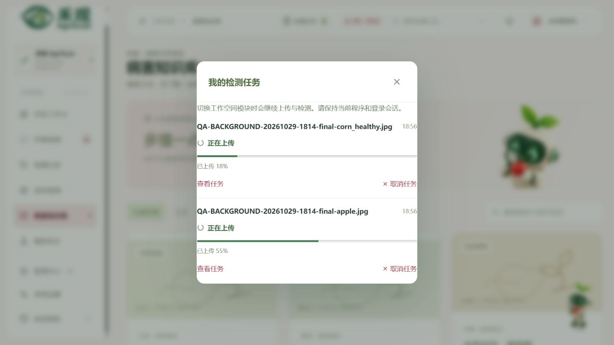
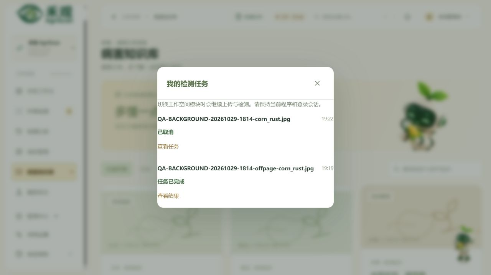

# 2026-10-29 双模型、后台任务与邮件账号功能验收

正式入口：[官网](https://agriscan.ming-ai.top/agriscan/)、[网页版](https://agriscan.ming-ai.top/agriscan/workspace/#login)、[管理端](https://agriscan.ming-ai.top/agriscan/admin/)、[Android 测试版](https://agriscan.ming-ai.top/agriscan/downloads/agriscan-test.apk)。本次点击验收使用正式域名，未以本地页面或关闭 TLS 校验代替。

## 当前版本

| 项目 | 最终结果 |
| --- | --- |
| 生产版本 | `release-20261029-dual-model-190833` |
| 网页版本 | 1.0.4，入口 `index-DjenaemU.js` |
| 管理端入口 | `index-DlavB476.js` |
| Android | `cn.agriscan.mobile`，1.0.4 / versionCode 5，沿用原测试签名 |
| APK 大小 | 24,164,454 字节 |
| 迁移 / 配置 | `20261029_06` / v11；此次无需数据库迁移 |
| 发布关联源文件 | 327 项逐文件 SHA256 核对通过，另提交文档和共享核心回归测试 |

[完整发布源清单](releases/20261029-1.0.4.json)记录产品源码、构建入口及模型身份。清单的 `base_commit` 表示本次开发起点，发布内容由 `sources` 中的逐文件校验值确定。

APK SHA256：

```text
6cbf093162521271ed4fca39aa8e6a3694286653bf13440d056443c210b98026
```

公网采用正常 DNS 与可信 HTTPS，单次完整 GET 实际读取 24,164,454 字节并计算 SHA256，耗时 157.16 秒，无传输错误；下载前后版本元数据及校验文件一致。APP 已完成构建、签名、ZIP CRC、默认 HTTPS 地址及打包资源检查，尚未进行真机验收。

## 功能与实际点击

| 检查 | 结果 |
| --- | --- |
| 两份权重共同使用 | 目标检测输出真实框与主结论，分类模型独立复核整张图片；38 项显式类别对应，不融合两类分数 |
| 自动作物与完成页面 | 苹果、玉米实际识别成功，主题自动切换；完成后展示结果与三步完成状态，支持继续选图 |
| 真实图片对照 | 原图与模型矩形框同屏；多目标玉米照片实际输出 2 个框，独立分类提示需人工复核 |
| 跨模块与并发 | 两张图片同时上传，离开检测页后继续；任务均完成，各自结果保持对应 |
| 离页完成 | 停留知识库时任务完成，页面与焦点未被强制切回，不自动弹出助手 |
| 主动取消 | 实际上传约 15% 时取消，服务器最终确认“已取消”，未生成检测记录 |
| 小禾与历史 | 图片建议与当前结果对应，历史菜单向左展开；上游临时失败时保留检测结果，重试后成功 |
| 地块与位置 | 创建本人地块，保存并重开核对面积和 WGS84 坐标；底图加载、地图切页、缩放后关闭通过 |
| 数据隔离 | 当前管理员的个人接口访问另一用户记录及图片均返回 404，响应为 `private, no-store`，未读取对方正文 |
| 账号与邮件页面 | 正式注册页显示邮箱验证码；找回密码入口与个人验证邮箱表单可用，管理端显示邮件已配置且不回显授权码 |


<table><tr><td width="50%"></td><td width="50%"></td></tr></table>

本次修复了轮询使上传状态回退、GET 先找回任务而 POST 超时后无法继续上传，以及本地先断流造成主动取消显示失败的竞态。相关行为已经加入[共享核心测试](../shared/README.md)。Nginx API 代理改为流式接收文件，避免整包缓冲消耗任务预留时间。

## 邮件与账号边界

新的 QQ SMTP 授权码已经通过生产服务器 SSL/TLS 登录认证，邮件配置以密文保存到数据库。只修改 SMTP 相关字段，原注册开关、AI 密钥及其他设置保留；管理端可维护主机、端口、传输方式、发件人和授权码。未发送测试邮件，实际收件尚未验证。

历史邮箱关联不自动视为已验证。旧账号仍能登录时，应先在系统设置验证绑定邮箱；忘记密码仅向已验证、仍归属该账户的邮箱发送重置码。验证码用途隔离、有效期与限流、管理员改邮箱后证明失效、密码重置后撤销旧会话均有后端回归覆盖。

## 验证与发布保护

- 后端完整回归 311 项通过、1 项 Windows 符号链接权限相关跳过；后续账号与管理专项 65 项、SMTP 配置快照专项 22 项通过。
- 共享任务核心 `node --test shared/tests/detectionTasks.test.mjs`：21 项全部通过；另有独立上传与取消时序检查。
- 桌面、管理端及移动端 TypeScript / Vite 构建通过；5 张真实 ONNX 技术烟测通过，不能作为田间准确率评估。
- 首次新后端发布后，后续两次修正仅原子切换静态版本，校验后端及两套模型字节完全一致，未重启 API、改写环境或数据库配置。Nginx 使用平滑 reload；API 重启次数保持 0。
- 当前服务进程观察到内存峰值约 714.8 MiB，限制 1400 MiB，`oom_kill=0`，健康接口正常；这不是容量压测结论。
- 只清理本次标记的 4 条检测及预测、4 张图片、4 段对话与 8 条消息、1 个地块及详情。保留私有 QA 备份和正常删除审计，17 张表非 QA 数据对照一致，配置版本保持 v11。

## 使用范围

后台任务覆盖保持登录时离开检测页、切换模块；不保证关闭程序、刷新页面、退出登录或服务重启后的续传。后端使用一个进程、两个有界处理线程及共享推理通道，避免重复加载权重。

地图已增加加载、慢网络、失败和重试反馈，也可手填成对经纬度。本次实测底图能显示，但国内地图 Key 尚未提供，海外底图的网络可用性仍受环境影响。Android 相机、厂商权限与实际安装体验由真机继续验收。
