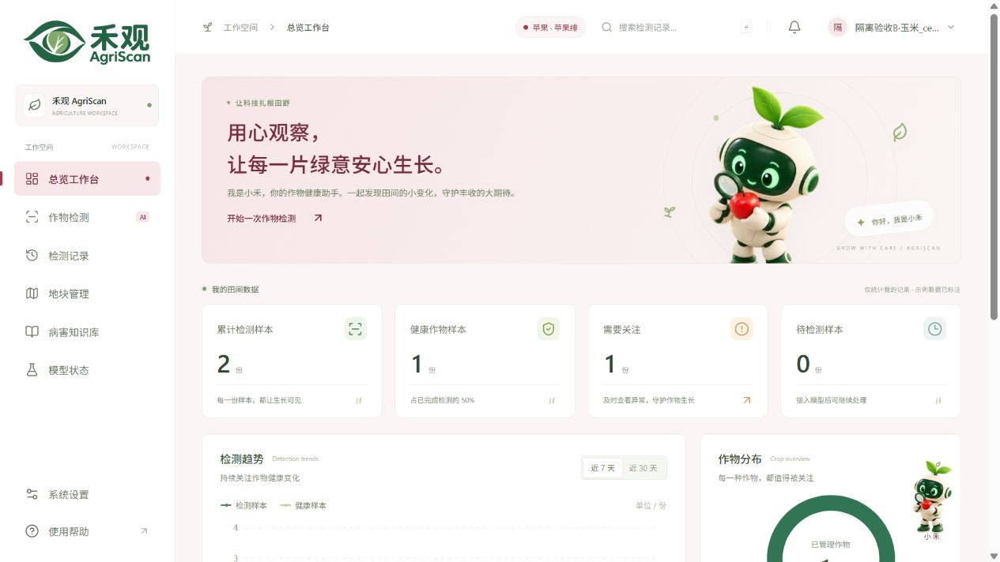
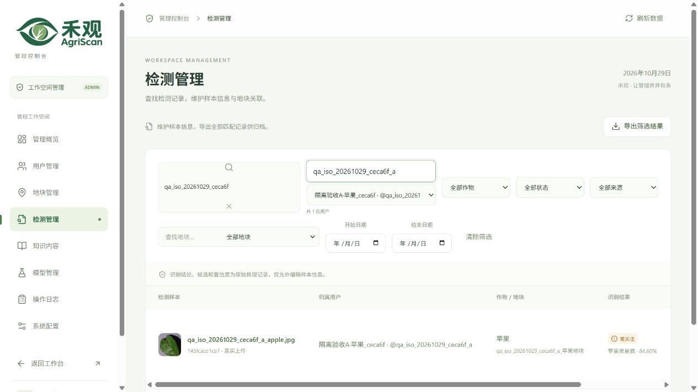

# 用户数据隔离修复与生产验收 · 2026-10-29

生产网址为 [agriscan.ming-ai.top](https://agriscan.ming-ai.top/)。检测、地块、统计、图片和检测讨论现在按账户归属隔离；管理员在用户端也只看到自己的数据，跨用户维护仅限独立管理端。

## 问题与修复

旧设计将检测和地块作为共享工作空间数据，没有保存上传者归属，仪表盘缓存也只按统计天数复用。两普通账户复现已确认：B 的列表和详情可以读到 A 新上传的样本。修复前的两个最小回归均失败，修复后通过。

| 数据入口 | 新行为 |
| --- | --- |
| 检测上传与视频采样 | 由服务端写入当前用户 `owner_id`，不能由客户端指定他人 |
| 列表、搜索、详情与删除 | 始终限定本人；访问他人 ID 返回 404 |
| 仪表盘 | 总量、趋势、分布和最近记录均限定本人；Redis 按用户及 7/30 天分键 |
| 地块与封面 | 每个账户可管理自己的地块，只允许关联自己的检测与地块 |
| 图片 | 除登录验证外，检查其关联记录的归属；他人的原图与封面返回 404 |
| 检测讨论 | 源检测必须存在且属于会话用户；未知、已删除或转给他人的源检测讨论隐藏，数据库内容保留 |
| 独立文字对话 | 继续按会话用户隔离，不受其他账户影响 |
| 管理端 | 专用 `/api/admin/*` 接口全量查看、按归属筛选、分配历史记录；普通成员为 403 |

图片、视频与图片分析在提交前再次核对归属并加行锁，避免推理期间管理员转移归属造成错误关联。所有 API 响应使用 `private, no-store`、`Vary: Authorization`；客户端请求和安全图片加载也强制 `no-store`。退出、登录或切换服务会清理旧数据、详情及图片临时 URL，迟到请求不能回填新账户。

知识库、识别模型及平台运行配置仍由管理员统一维护，同一用户可以在手机和网页同步自己的数据。

## 历史记录与管理员分配

数据库升级为 `20261029_06`，给检测和地块增加可为空的 `owner_id`、索引和用户外键（删除账户时 SET NULL）。无法可靠确认原上传者的历史记录保留 NULL，不猜测或自动归给某个账户，也不删除记录或图片。

管理员在[检测管理](https://agriscan.ming-ai.top/agriscan/admin/#admin/detections)或[地块管理](https://agriscan.ming-ai.top/agriscan/admin/#admin/plots)选择「历史待分配」，确认归属后在编辑表单选择用户。检测与关联地块必须属于同一用户；转移检测时应解除原关联或选择目标用户的地块。地块存在其他归属的关联检测时，修改归属返回 409，须先处理关联，不会静默批量转移。

历史检测讨论也需源检测归属明确后才向对应会话用户显示；隐藏不会删掉数据库中的旧消息。普通账户不能通过已知记录 ID、图片地址、讨论 ID 或管理员身份的个人接口绕过隔离。

## 验证结果

| 检查 | 实际结果 |
| --- | --- |
| 后端完整回归 | **254 passed，1 skipped**；唯一跳过项为 Windows 无符号链接创建权限 |
| 真实生产服务预检 | 196 项通过，使用生产 MySQL、Redis 和真实 YOLO 模型 |
| 实际缓存 | A/B × 7/30 天的四个 Redis 键不同，缓存值与各自 API 和数据库归属一致 |
| 正常 DNS 公网 HTTPS | 246 项通过，TLS 1.3，证书主机名校验正常；没有使用 localhost、resolve 或关闭证书验证替代公网检查 |
| 浏览器账户 A | 仅 1 条苹果检测、1 个本人地块；自己的详情与图片正常 |
| 浏览器账户 B | 仅 2 条玉米检测、1 个本人地块；搜索 A 样本为 0 条 |
| 同页切换 A → B | A 退出后登录 B，只显示 B 的两条玉米记录，无 A 的残留 |
| 浏览器管理员 | 按 A 的归属筛选为 1 条；归属编辑与同用户地块选项正常，未保存测试编辑 |
| 越权与旧数据 | 对方详情、图片、封面和关联地块均 404；未知旧讨论不向普通用户展示 |
| 测试清理 | 66 项通过，仅删除精确白名单内的测试账户、检测、地块、图片、对话和暂存源图 |

## 发布与数据保留

修复期间临时暂停了个人数据接口，避免继续暴露他人数据；在生产预检通过后移除临时保护并恢复服务。新版位于 `/srv/agriscan/releases/release-20261029-user-isolation-104127`，发布前在受限目录完整备份 MySQL，升级后验证真实外键及其 SET NULL 删除策略。

原有用户、检测、预测、图片及会话按具体主键逐项保护，数据哈希保持一致；恢复服务后其他用户新增的数据也保留。DeepSeek 的 v6 加密配置行未改变，模型与证书保持不变。不要回滚到没有归属校验的旧代码；数据库升级保留归属，失败应保持访问保护并向前修复。

Android **1.0.2 / code3** 沿用原签名，包含账户切换清理及禁用个人数据缓存。APK 大小为 18,744,688 字节，SHA256 为 `e343102879bd91e6a59715ec8fa3a491800520e603dfc1605e938ca25d91a605`；签名、ZIP、包内地址、隐私补丁及公网整包下载校验通过。APP 真机交互仍由用户验收。网页首次使用请刷新，手机建议覆盖安装新版。

本次界面从固定源码基线叠加隔离补丁构建，未夹入其他任务尚未完成的界面设计；其工作区改动保留。测试凭据已清除，源码、构建产物与报告均不包含生产密钥。
